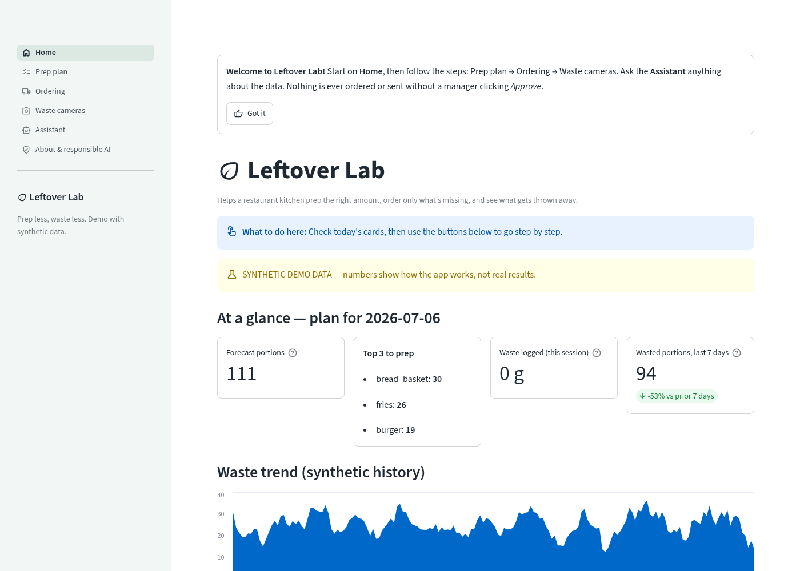
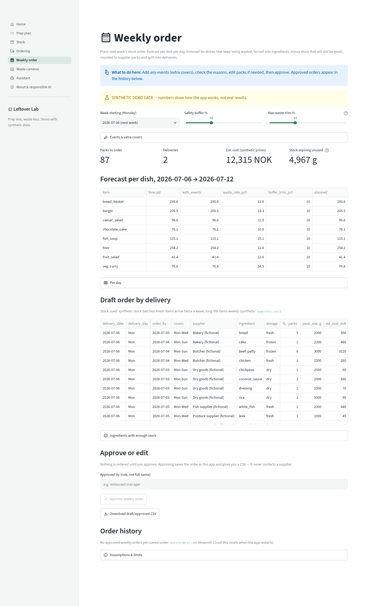
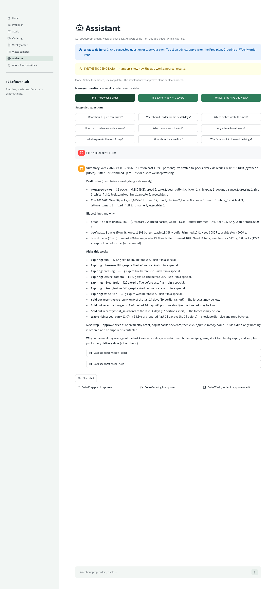
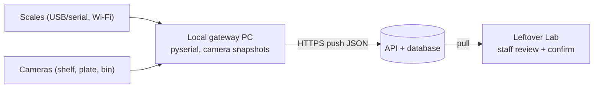

# Leftover Lab — food waste prep planner

A small Streamlit app that helps a restaurant kitchen **prep the right amount, know what's in stock and what expires, order only what's missing, and see what gets thrown away**, with staff confirming every step.

- **Synthetic data only.** All sales, recipes, stock, suppliers and plate images are generated/illustrations — not from a real restaurant.
- **Prepared before the AI for Good Hackathon (19 Oct 2026, Oslo) as a disclosed starter template; built with AI assistance.** The hackathon prototype itself is built during the event (see `DISCLOSURE.md`).



## How it works
1. **Forecast** — same-weekday average of recent sales predicts tomorrow's portions.
2. **Approve prep** — suggestions with a reason; the manager edits and approves.
3. **Check stock** — shelf cameras count packs, scales weigh the rest; staff confirm; use what expires first (FIFO).
4. **Order what's missing** — daily top-ups (Ordering) or a **weekly order** for next Monday–Sunday: forecast × recipe grams − stock that won't expire first, rounded up to supplier packs and split into fresh (twice-weekly) and dry (weekly) deliveries; a person approves, nothing is sent.
5. **Log waste** — plate-return and kitchen-bin entries (staff-confirmed) show what's thrown away, to tune the next forecast.

## Pages
| Page | What you do | Screenshot |
|---|---|---|
| Home | Today's cards (forecast portions, top 3 to prep, waste logged, waste trend) and start-here links | [home](docs/screenshots/home.png) |
| Prep plan | Edit suggested portions, approve with your role | [prep](docs/screenshots/prep.png) |
| Stock | Overview by location (dry store, walk-in fridge, back fridge, freezer); **shelf camera** (sample / upload / webcam / IP snapshot → pack counts → edit → tick "checked" → confirm); **scales** (simulated, HTTP/JSON pull, CSV import, serial ASCII lines → plausibility flags → tick → apply); **expiry & use first** with dishes per ingredient; **how devices connect** | [stock](docs/screenshots/stock.png), [shelf](docs/screenshots/stock_shelf.png), [expiry](docs/screenshots/stock_expiry.png), [devices](docs/screenshots/stock_devices.png) |
| Ordering | Supplier order per ingredient with a *why* column; approve → download CSV (nothing is sent) | [order](docs/screenshots/order.png) |
| Weekly order | Next Monday–Sunday: forecast per dish per day (same-weekday average), **events** (+N covers / +% on a day), buffer trimmed by each dish's recent waste rate (capped), ingredients minus stock that won't expire first, packs per delivery with a plain-language reason; **Approve** saves the order (`data/orders/`, JSON + CSV) and lists it in an **order history** with forecast vs actual; CSV download | [weekly](docs/screenshots/weekly_order.png) |
| Waste cameras | **Plate return camera**: sample / upload / device webcam / IP-camera snapshot → leftover estimate → staff confirm → grams per ingredient. **Kitchen bin camera**: scale grams + reason. Explainer on connecting real cameras | [cameras](docs/screenshots/cameras.png) |
| Assistant | Chat that answers from the app's data (prep, orders, waste, worst dishes, busy weekdays) with a *Why* line. Manager questions ("Plan next week's order", "Big event Friday, +40 covers", "What are the risks this week?") get a summary, the draft order, risks and an *Approve or edit* next step; advises only | [chat](docs/screenshots/chat.png), [weekly plan](docs/screenshots/chat_weekly_plan.png) |
| About & responsible AI | Data sources, limits, human oversight, privacy | [about](docs/screenshots/about.png) |

## Run locally (Python 3.10+; run from the repo root so the theme in `.streamlit/config.toml` loads)
Windows PowerShell:
```powershell
py -m venv .venv
.\.venv\Scripts\Activate.ps1     # if blocked: Set-ExecutionPolicy -Scope Process RemoteSigned
pip install -r starter/requirements.txt
pytest -q starter
streamlit run starter/app.py
```
macOS / Linux:
```bash
python3 -m venv .venv && source .venv/bin/activate
pip install -r starter/requirements.txt
pytest -q starter
streamlit run starter/app.py
```
Optional:
- **LLM mode** (assistant tool-calling + vision plate estimate): `pip install openai`, set `LLM_API_KEY` (and `LLM_BASE_URL`, `LLM_MODEL` [default gpt-4o-mini], `VISION_MODEL` [default gpt-4o-mini] for OpenAI-compatible providers). Never commit keys. Without a key everything works offline.
- **IP-camera snapshots**: `pip install opencv-python-headless`.
- Regenerate data: `python data/generate_synthetic_restaurant_data.py --seed 42 --out data/synthetic_restaurant_daily.csv`, `python data/make_sample_plates.py`, `python data/make_stock_data.py`, `python data/make_suppliers.py`.

## Weekly order


`starter/weekly.py` (pure functions, tested step by step): forecast window = the Monday after the last sales date → Sunday; events scale a day (+N covers ≈ N extra mains); planned = forecast × (1 + buffer) × (1 − min(waste rate, max trim)), never below the forecast; ingredients via `recipes.csv`; stock batches are used soonest-expiry first and only before their expiry date; shortfall per delivery window is rounded up to packs (`suppliers.csv` `delivery_days`, `lead_time_days`; synthetic). Every reason is built only from computed values. Approved orders are saved under `data/orders/` (git-ignored; on Streamlit Cloud this folder resets when the app restarts — download the CSV).

## The assistant


It calls ten deterministic functions over the app's data — `get_weekly_order`, `get_week_risks`, `get_prep_plan`, `get_order_suggestions`, `get_waste_summary`, `get_worst_waste_dishes`, `get_weekday_pattern`, `get_stock_levels`, `get_expiring_items`, `get_use_first_advice` — and shows the data it used. Offline it picks the function by keywords; with an LLM, the model calls the same functions and any number in its reply that isn't in the function results is flagged. It never approves plans or places orders.

## Cameras, scales and the local gateway
Streamlit Community Cloud (or any cloud host) **cannot reach cameras or scales on the restaurant network**. A real deployment needs a small local gateway that reads the devices and pushes readings out:



Scale connectors live in `starter/scales.py` behind one `Reading(scale_id, location, ingredient, grams, timestamp, source)` dataclass:
| Connector | Use |
|---|---|
| `SimulatedScale` | Deterministic synthetic readings (demo default; one deliberately odd reading to show flagging) |
| `HttpJsonScale(url)` | GET a URL returning `{"readings": [{scale_id, location, ingredient, value, unit, timestamp}]}`; 5 s timeout, schema validation, g/kg/lb/oz conversion |
| `parse_csv` | CSV export from a gateway: `scale_id,location,ingredient,value,unit,timestamp` |
| `parse_ascii_line` | Serial/USB scales' ASCII lines like `ST,GS,+  1.234kg` (ST stable, US unstable, OL overload). Read the port with `pyserial` on the gateway — **optional, not a requirement of this app** |

`check_plausibility()` flags negative, over-max and sudden-jump readings; flagged readings start unticked and nothing changes stock until staff apply it. Shelf counts use a vision LLM (strict JSON, validated against known items) if `LLM_API_KEY` is set, otherwise a **demo heuristic** that only works on the bundled synthetic shelf drawings. Cameras count packs — not how full a sack is, and they can't read expiry dates.

## Deploy on Streamlit Community Cloud
1. share.streamlit.io → **Create app** → GitHub repo `antequeradiogo-stack/food-waste-prep-planner`.
2. Branch `main` · Main file path `starter/app.py` · Python 3.12.
3. (Optional) Secrets: `LLM_API_KEY = "..."` (and add `openai>=1.0` to `starter/requirements.txt`).

## Contents
| Path | What |
|---|---|
| `starter/app.py` | Entry point: theme, navigation, onboarding tip |
| `starter/views/` | Pages: home, prep, stock, order, weekly, cameras, chat, about |
| `starter/weekly.py` | Weekly order: forecast window, events, waste-trimmed buffer, expiry-aware stock netting, packs per delivery, reasons, approve/save/history, risks |
| `starter/ui.py` | Shared data loading, header/banner, how-it-works |
| `starter/core.py` | Forecast + prep suggestions |
| `starter/ordering.py` | Order = forecast × recipe − stock, rounded to packs |
| `starter/stock.py` | Batches → on-hand grams, by location, expiry, use-first, FIFO updates |
| `starter/shelf.py` | Shelf pack counts (vision LLM or demo heuristic) + strict JSON validation |
| `starter/scales.py` | Scale connector interface (simulated, HTTP/JSON, CSV, serial ASCII) + plausibility checks |
| `starter/plate_waste.py` | Leftover estimate (vision LLM or heuristic), JSON validation, recipe gram math |
| `starter/assistant.py` | Assistant tools, offline answers, LLM tool-calling, number check |
| `starter/cameras.py` | One-frame IP-camera grab (optional OpenCV) |
| `starter/tests/` | pytest + Streamlit AppTest (every page loads, approvals, confirm flows, chat) |
| `data/` | Synthetic sales, recipes, stock batches, suppliers, plate + shelf illustrations, generators (`make_stock_data.py`, `make_suppliers.py`) + data card |
| `docs/screenshots/` | Screenshots (headless Chrome, synthetic data) |
| `PITCH.md`, `DISCLOSURE.md`, `RESPONSIBLE_AI.md`, `BACKUP_GRANT_AGENT.md` | Hackathon materials |

## Limits
Same-weekday averages ignore weather, holidays and menu changes; sales history undercounts demand on sold-out days; suggestions are never orders. Plate-waste estimates are **unvalidated**: they need calibration against weighed plates in a pilot; camera at the plate-return station only, no guests in frame (GDPR). Shelf-count heuristic is demo-only; real devices need a local gateway. Stock changes, the waste log and chat live in the browser session only. MIT licensed — see `LICENSE`.
